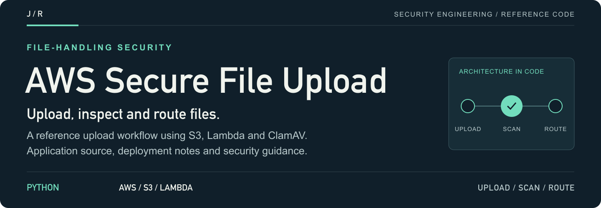
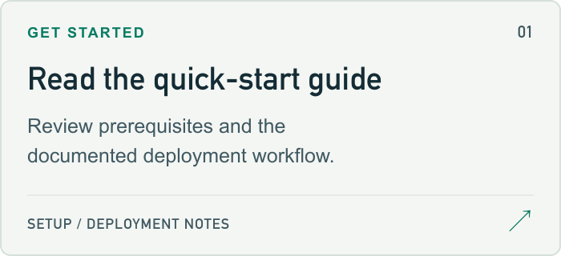
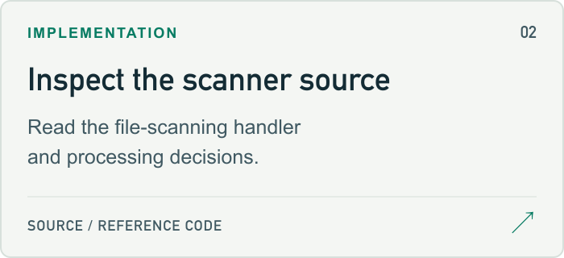
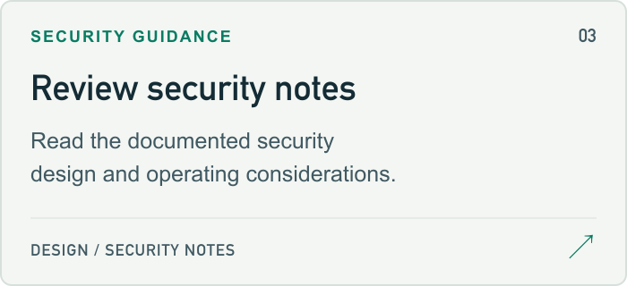
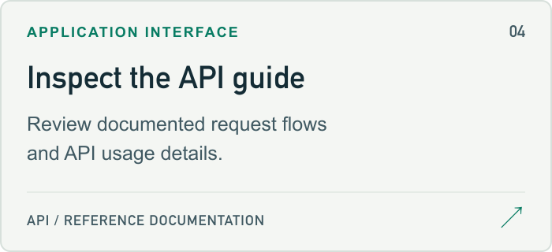

<a id="aws-secure-file-upload-system-with-malware-scanning"></a>

<a href="#setup-guide">
<picture>
  <source media="(max-width: 600px)" srcset="docs/assets/readme/header-mobile.png">
  
</picture>
</a>

<p>
  <a href="#setup-guide"><strong>Start here ↗</strong></a> &nbsp; / &nbsp;
  <a href="lambda-functions/malware-scanner/scanner.py">Source</a> &nbsp; / &nbsp;
  <a href="#project-guide">Project guide</a> &nbsp; / &nbsp;
  <a href="https://github.com/jmragsdale">Profile</a>
</p>

An AWS file-upload reference using S3, Lambda and ClamAV, with application source, deployment documentation and security notes.

## Explore the project

Open a card for source, examples or supporting documentation.

<p>
<a href="QUICKSTART.md">
<picture>
  <source media="(prefers-color-scheme: dark)" srcset="docs/assets/readme/setup-dark.png">
  
</picture>
</a>
<a href="lambda-functions/malware-scanner/scanner.py">
<picture>
  <source media="(prefers-color-scheme: dark)" srcset="docs/assets/readme/source-dark.png">
  
</picture>
</a>
<a href="docs/SECURITY.md">
<picture>
  <source media="(prefers-color-scheme: dark)" srcset="docs/assets/readme/security-dark.png">
  
</picture>
</a>
<a href="docs/API.md">
<picture>
  <source media="(prefers-color-scheme: dark)" srcset="docs/assets/readme/api-dark.png">
  
</picture>
</a>
</p>

## Project guide

A serverless, cloud-native secure file upload system built on AWS that automatically scans uploaded files for malware before storing them. This project demonstrates AWS security best practices including encryption, least privilege access, malware detection, and comprehensive audit logging.

## 🎯 Project Overview

This system allows users to securely upload files through a web interface. Each uploaded file is:
1. Validated for type and size
2. Uploaded to S3 using presigned URLs
3. Automatically scanned for malware using ClamAV
4. Encrypted and stored securely if clean
5. Quarantined if suspicious
6. Logged for compliance and auditing

## 🏗️ Architecture

```
User → CloudFront (CDN) → S3 (Static Website)
                              ↓
                        API Gateway (REST API)
                              ↓
                    Lambda (Generate Presigned URL)
                              ↓
User uploads directly → S3 Upload Bucket (Encrypted with KMS)
                              ↓
                        S3 Event Notification
                              ↓
                    Lambda (Malware Scanner with ClamAV)
                              ↓
                ┌─────────────┴─────────────┐
                ↓                           ↓
        S3 Clean Bucket              S3 Quarantine Bucket
        (Encrypted)                  (Encrypted)
                ↓                           ↓
        SNS Topic                    SNS Topic
        (Success)                    (Security Alert)
                ↓                           ↓
            Email                        Email
            
All activity logged to:
- CloudTrail (API calls)
- CloudWatch Logs (Lambda execution)
- S3 Access Logs
```

## 🔒 Security Features

### 1. Authentication & Authorization
- IAM roles with least privilege principle
- API Gateway with API key authentication
- Resource-based policies on S3 buckets
- Lambda execution roles with minimal permissions

### 2. Encryption
- **At Rest**: S3 buckets encrypted with AWS KMS customer-managed keys
- **In Transit**: TLS 1.2+ enforced for all connections
- **Presigned URLs**: Time-limited (15 minutes) secure upload URLs

### 3. Network Security
- VPC deployment for Lambda functions
- Private subnets with NAT Gateway
- Security Groups with minimal ingress rules
- AWS WAF protecting CloudFront and API Gateway

### 4. Malware Detection
- ClamAV antivirus engine running in Lambda
- Automatic virus definition updates
- Immediate quarantine of suspicious files
- Security team notifications via SNS

### 5. Audit & Compliance
- CloudTrail logging all API calls
- CloudWatch Logs for Lambda execution
- S3 Server Access Logging
- CloudWatch Alarms for security events

### 6. Input Validation
- File type whitelist enforcement
- Maximum file size limits (50MB)
- Content-Type validation
- Filename sanitization
- Rate limiting via API Gateway

## 📋 Prerequisites

- AWS Account
- Terraform >= 1.5.0
- AWS CLI configured with appropriate credentials
- Docker (for building Lambda layers with ClamAV)
- Python 3.9+
- Git

<a id="setup-guide"></a>

## 🚀 Deployment

### Step 1: Clone and Configure

```bash
git clone <your-repo>
cd aws-secure-file-upload
```

### Step 2: Configure Variables

Edit `terraform/terraform.tfvars`:

```hcl
aws_region      = "us-east-1"
project_name    = "secure-file-upload"
environment     = "prod"
alert_email     = "security@yourcompany.com"
allowed_file_types = ["image/jpeg", "image/png", "application/pdf"]
max_file_size_mb = 50
```

### Step 3: Build Lambda Layers

```bash
cd lambda-layers
./build-clamav-layer.sh
cd ..
```

### Step 4: Deploy Infrastructure

```bash
cd terraform
terraform init
terraform plan
terraform apply
```

### Step 5: Deploy Frontend

The Terraform will output the CloudFront URL. Update the API endpoint in `frontend/upload.js` with the API Gateway URL from Terraform outputs, then:

```bash
aws s3 sync ../frontend s3://$(terraform output -raw website_bucket_name)
```

## 📁 Project Structure

<details>
<summary>Architecture flow (text)</summary>

```
aws-secure-file-upload/
├── README.md
├── architecture-diagram.png
├── terraform/
│   ├── main.tf                 # Main Terraform configuration
│   ├── providers.tf            # AWS provider configuration
│   ├── variables.tf            # Input variables
│   ├── outputs.tf              # Output values
│   ├── terraform.tfvars        # Variable values (gitignored)
│   ├── iam.tf                  # IAM roles and policies
│   ├── s3.tf                   # S3 buckets configuration
│   ├── kms.tf                  # KMS encryption keys
│   ├── lambda.tf               # Lambda functions
│   ├── api-gateway.tf          # API Gateway configuration
│   ├── cloudfront.tf           # CloudFront distribution
│   ├── cloudwatch.tf           # Monitoring and alarms
│   ├── sns.tf                  # SNS topics for notifications
│   ├── waf.tf                  # WAF rules
│   └── vpc.tf                  # VPC and networking
├── lambda-functions/
│   ├── upload-handler/
│   │   ├── handler.py          # Generate presigned URLs
│   │   ├── requirements.txt
│   │   └── tests/
│   └── malware-scanner/
│       ├── scanner.py          # ClamAV scanning logic
│       ├── requirements.txt
│       └── tests/
├── lambda-layers/
│   ├── build-clamav-layer.sh   # Script to build ClamAV layer
│   └── python-requirements/
│       └── requirements.txt
├── frontend/
│   ├── index.html              # Upload interface
│   ├── upload.js               # Upload logic with presigned URLs
│   └── styles.css              # Styling
├── tests/
│   ├── integration/
│   └── unit/
└── docs/
    ├── DEPLOYMENT.md
    ├── SECURITY.md
    └── TROUBLESHOOTING.md
```

</details>

## 🔧 Configuration Options

### File Type Restrictions

Edit `terraform.tfvars` to customize allowed file types:

```hcl
allowed_file_types = [
  "image/jpeg",
  "image/png",
  "image/gif",
  "application/pdf",
  "application/zip",
  "text/plain"
]
```

### File Size Limits

```hcl
max_file_size_mb = 50  # Maximum 50MB per file
```

### Alert Email

```hcl
alert_email = "security-team@yourcompany.com"
```

## 📊 Monitoring & Alerts

### CloudWatch Dashboard

Automatically created dashboard includes:
- Upload success/failure rates
- Malware detection events
- Lambda execution duration
- API Gateway 4xx/5xx errors
- S3 bucket metrics

### SNS Alerts

You'll receive email notifications for:
- ✅ Successful file uploads (optional)
- 🚨 Malware detected
- ⚠️ Scanner failures
- 🔥 Lambda errors
- 📈 Unusual activity patterns

### CloudWatch Alarms

Pre-configured alarms for:
- High error rates (>5%)
- Lambda throttling
- Scanner execution failures
- API Gateway latency spikes

## 🧪 Testing

### Test File Upload

```bash
# Get upload URL
UPLOAD_URL=$(curl -X POST https://your-api-id.execute-api.us-east-1.amazonaws.com/prod/get-upload-url \
  -H "x-api-key: your-api-key" \
  -H "Content-Type: application/json" \
  -d '{"filename": "test.pdf", "contentType": "application/pdf"}' | jq -r '.uploadUrl')

# Upload file
curl -X PUT "$UPLOAD_URL" \
  --upload-file test.pdf \
  -H "Content-Type: application/pdf"

# Check scan results (wait 30 seconds)
aws s3 ls s3://your-clean-bucket-name/
```

### Test Malware Detection

```bash
# Download EICAR test file (safe malware test file)
curl -o eicar.txt https://secure.eicar.org/eicar.com.txt

# Upload it (should be quarantined)
# Follow same process as above
```

## 💰 Cost Estimation (Monthly)

Assuming 10,000 file uploads per month (5MB average):

| Service | Cost |
|---------|------|
| S3 Storage (50GB) | $1.15 |
| Lambda Invocations (20,000) | $0.40 |
| Lambda Duration | $2.00 |
| API Gateway (10,000 requests) | $0.035 |
| CloudFront (10GB transfer) | $0.85 |
| KMS Requests | $0.30 |
| CloudWatch Logs | $0.50 |
| SNS Notifications | $0.10 |
| **Total** | **~$5.35/month** |

*Free tier can reduce costs significantly for new AWS accounts*

## 🔐 Security Best Practices Demonstrated

1. **Least Privilege Access**: Every resource has minimal required permissions
2. **Defense in Depth**: Multiple layers of security (WAF, encryption, scanning)
3. **Encryption Everywhere**: Data encrypted at rest and in transit
4. **Audit Logging**: Complete audit trail of all activities
5. **Automated Scanning**: No manual intervention required
6. **Incident Response**: Automatic quarantine and alerting
7. **Network Isolation**: Lambda functions in private VPC subnets
8. **Secret Management**: No hardcoded credentials
9. **Input Validation**: Multiple validation layers
10. **Compliance Ready**: Structured logging for compliance requirements

## 📚 Documentation

- [Deployment Guide](docs/DEPLOYMENT.md)
- [Security Architecture](docs/SECURITY.md)
- [Troubleshooting](docs/TROUBLESHOOTING.md)
- [API Documentation](docs/API.md)

## 🐛 Troubleshooting

### Lambda Scanner Timeout
- Increase Lambda timeout in `terraform/lambda.tf`
- Check ClamAV database is up to date

### Files Not Being Scanned
- Verify S3 event notification configuration
- Check Lambda execution role permissions
- Review CloudWatch Logs for scanner function

### Upload Failures
- Verify presigned URL hasn't expired (15min limit)
- Check file size is within limits
- Verify Content-Type matches allowed types

## 🚀 Future Enhancements

- [ ] Add thumbnail generation for images
- [ ] Implement file deduplication
- [ ] Add user authentication (Cognito)
- [ ] Create admin dashboard
- [ ] Add file sharing capabilities
- [ ] Implement file versioning
- [ ] Add OCR for document indexing
- [ ] Multi-region replication

## 📄 License

MIT License - See LICENSE file for details

## 👤 Author

Your Name - [GitHub](https://github.com/jmragsdale)

## 🙏 Acknowledgments

- ClamAV open-source antivirus engine
- AWS Security Best Practices documentation
- Terraform AWS modules community

<details>
<summary>README visual assets</summary>

[Artwork sources and regeneration notes](docs/assets/readme/README.md).

</details>
